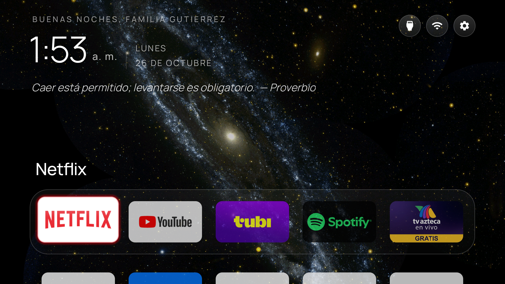

# 🌌 Nebula TV Launcher

Una pantalla de inicio minimalista estilo **Apple TV** para **Android TV / Google TV**, con
**glassmorphism**, fondos que cambian por hora del día, saludo dinámico y animaciones suaves —
**optimizada para TVs de 1 GB de RAM**.



> Basado en [CleanYourTV](https://github.com/Gathin23/cleanyourtv) (MIT). ¡Gracias a sus autores!

---

## ✨ Características
- **Glassmorphism**: dock y botones de cristal esmerilado translúcido.
- **Fondos por hora del día**: amanecer, día, tarde y noche; cambian solos (y rotan como *slideshow*
  en el protector de pantalla). Todo **offline**.
- **Saludo dinámico**: "Buenos días / tardes / noches, <tu nombre>" según la hora.
- **Reloj grande** con formato 12h o 24h, y **frase motivacional diaria** (estilo Brian Tracy).
- **Animaciones suaves**: foco con escala y brillo del color de cada app, reflejo de cristal, rebote
  al abrir. Solo `transform`/`opacity` (aceleradas por GPU), **sin blur en tiempo real**.
- **Protector de pantalla**: reloj y fecha grandes y centrados sobre tus fondos.
- **100% configurable** desde un solo `config.json` (sin recompilar para cambiar nombre, apps o fondos).

## ✅ Requisitos y compatibilidad
- Una **Android TV o Google TV** (Xiaomi, TCL, Hisense, Sony, Nvidia Shield, etc.). **No** funciona en
  Samsung Tizen, LG webOS ni Amazon Fire TV.
- La TV y tu PC en la **misma red Wi-Fi**.
- En la PC: **Python 3**. (Para compilar desde código: JDK 17+ y Android SDK; no hace falta si usas el
  APK del *Release*.)

---

## 🤖 Instalación con tu agente de IA (lo más fácil)
1. Clona el repo:
   ```
   git clone https://github.com/UlisesG13/nebula-tv-launcher.git
   cd nebula-tv-launcher
   ```
2. Abre tu agente de IA en esa carpeta (**Claude Code**, **Cursor**, **Codex**, **Gemini CLI**...).
3. Dile:
   > **"Lee AGENTS.md e instálalo en mi TV."**

El agente verificará lo que falte, te guiará paso a paso para preparar la TV, te preguntará tu nombre,
tus apps y tus fondos, y hará la instalación por ti. No necesitas saber de tecnología.

## 🧑‍💻 Instalación manual (sin IA)
1. En la **TV**: Ajustes → Preferencias del dispositivo → **Acerca de** → pulsa **"Compilación" 7
   veces** → vuelve → **Opciones para desarrolladores** → activa **Depuración por USB**.
2. Anota la **IP** de la TV (Ajustes → Red e Internet → tu Wi-Fi).
3. Copia la config y edítala con tu nombre/apps/fondos:
   ```
   cp config/config.example.json config/config.json
   ```
4. Ejecuta el instalador (te pedirá aceptar el aviso de depuración en la TV):
   - **Windows:** `scripts\install.ps1 -TvHost 192.168.1.50`
   - **macOS/Linux:** `scripts/install.sh 192.168.1.50`
5. Presiona **Home** en el control. ¡Listo!

> **¿Prefieres no compilar?** Descarga el APK del último *Release* e instálalo con
> `tools/tv.py` (ver [AGENTS.md](AGENTS.md), Paso 4A).

---

## ⚙️ Personalización (`config/config.json`)
| Campo | Qué hace |
|---|---|
| `greeting.name` | Nombre que sigue al saludo ("Buenos días, **Familia Pérez**"). Vacío = solo el saludo. |
| `clock_format` | `"12h"`, `"24h"` o `"system"` (sigue el ajuste de la TV). |
| `schedule.morning` / `.day` / `.afternoon` / `.night` | Hora (0–23) en que empieza cada periodo. Debe ir en aumento. Define el saludo **y** qué fondo se muestra. |
| `wallpapers.morning/day/afternoon/night` | Ruta a cada imagen de fondo (las de `wallpapers/` o las tuyas). Se redimensionan solas. |
| `dock_apps` | Lista de *package names* en el orden del dock (ej. `com.netflix.ninja`). Para ver los instalados: `tools/tv.py 'pm list packages -3'`. |

Tras editar `config.json`, vuelve a correr el instalador (o pídele a tu agente que "reaplique la
config"). Para poner tus propios fondos, ver [`wallpapers/CREDITS.md`](wallpapers/CREDITS.md).

## ↩️ Desinstalar / volver al launcher original
- **Windows:** `scripts\uninstall.ps1 -TvHost 192.168.1.50`
- **macOS/Linux:** `scripts/uninstall.sh 192.168.1.50`

Reactiva el launcher de fábrica, quita Nebula y te recuerda apagar la depuración. (Cambiar o quitar el
launcher **no cierra tus cuentas** ni borra apps.)

## 🛠️ Solución de problemas
- **La TV no aparece / no conecta por ADB:** verifica que PC y TV estén en la **misma Wi-Fi**, que la
  **Depuración USB** esté activa y que escribiste la **IPv4** correcta (no la IPv6 con `:`).
- **Queda en `unauthorized` o no sale el aviso:** en la TV, Opciones de desarrollador → **"Revocar
  autorizaciones de depuración USB"**, apaga y enciende la Depuración USB, y reintenta. A veces ayuda
  reiniciar la TV (desenchufarla ~30 s) y reconectar.
- **El Home no cambia (sigue el de Google):** en **Google TV** el asistente de setup (`setupwraith`)
  suele reclamar el Home; hay que desactivarlo (con cuidado del Wi-Fi) además del launcher de fábrica.
  El instalador y [AGENTS.md](AGENTS.md) lo manejan; reintenta o pide a tu agente que lo resuelva.
- **Va lento:** el launcher está hecho para 1 GB de RAM; si notas tirones, usa fondos más livianos
  (los scripts ya los reducen) y evita imágenes enormes.

## 🙏 Créditos
- Launcher base y herramientas: **[CleanYourTV](https://github.com/Gathin23/cleanyourtv)** (MIT).
- Tipografía: **Manrope** (SIL Open Font License).
- Fondos: **NASA / ESA** — ver [`wallpapers/CREDITS.md`](wallpapers/CREDITS.md).
- Frases: Brian Tracy, Jim Rohn, Zig Ziglar y otros (atribuidas en la app).
- Licencia del proyecto: **MIT** (ver [LICENSE](LICENSE)).

---

## 🇬🇧 English (short)
**Nebula TV Launcher** — a minimalist, Apple-TV-style home screen for **Android TV / Google TV** with
glassmorphism, time-of-day wallpapers, a dynamic greeting, smooth animations and a daily quote,
**tuned for 1 GB-RAM TVs**. Based on [CleanYourTV](https://github.com/Gathin23/cleanyourtv) (MIT).

**Install with your AI agent (easiest):** clone the repo, open your AI coding agent (Claude Code,
Cursor, Codex, Gemini CLI) in the folder, and tell it: **"Read AGENTS.md and install it on my TV."**
It will check prerequisites, walk you through the TV setup, ask for your name/apps/wallpapers and do
everything.

**Manual:** on the TV enable Developer options (tap *Build* 7×) → USB debugging; note the TV's IP;
`cp config/config.example.json config/config.json`; run `scripts/install.ps1 -TvHost <ip>` (Windows)
or `scripts/install.sh <ip>` (macOS/Linux). Uninstall with `scripts/uninstall.*`. Works on Android
TV / Google TV only (not Tizen, webOS or Fire TV). MIT licensed; wallpapers are NASA/ESA — see
`wallpapers/CREDITS.md`.
